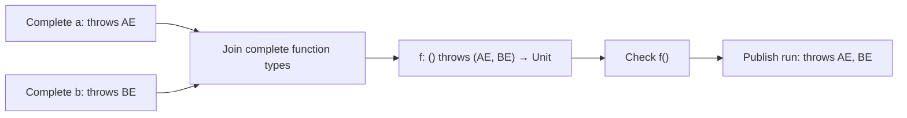
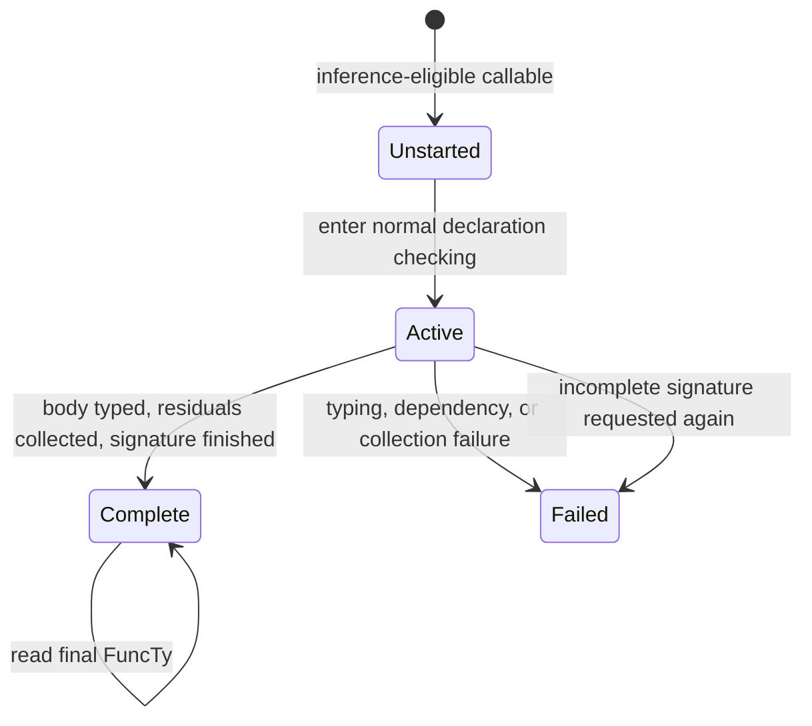
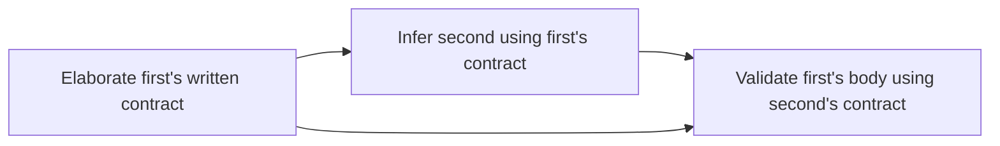
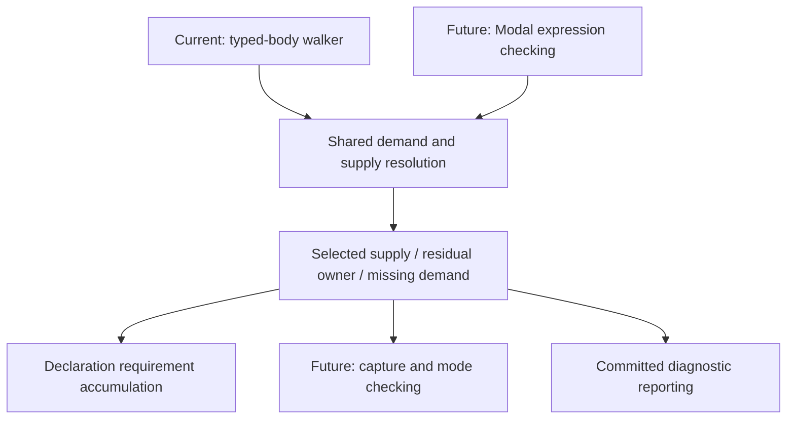
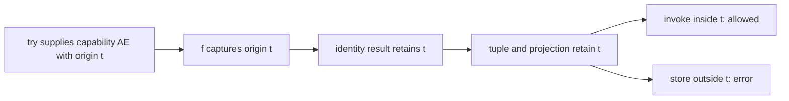

# Checked exceptions: dependency-ordered contract checking

This document describes the declaration-local checked-exception architecture and its integration requirements. Its semantic reference is [Checked exceptions for Cangjie](../Checked%20exceptions%20for%20Cangjie.md), sections 3, 5, and 6, with Modal integration deferred under §6.5. The working implementation now completes contracts during Sema and removes post-Sema inference, expression-type completion, and subtype replay. The section 6 extension below describes the implemented independent checking policies, producer metadata, and consumer-local assumption views; its acceptance results are recorded separately from the earlier migration baseline. Validation status is recorded in the acceptance section and [gap ledger](gap-analysis.md).

In this document, a declaration's **contract** means the complete static type information needed to check its uses. For a function, this includes parameter and result types, generic constraints, and capability requirements, including those nested in other types. A **contract dependency** exists when checking one declaration needs that information from another. These are architectural terms introduced here; the compiler already handles declaration-type dependencies through synthesis on use. The rewrite extends that mechanism to capability inference and makes signature completeness explicit.

**Decision, 2026-10-09:** reject recursive inference groups for now. A declaration may use a completed contract without requiring the callee's body to have been checked. Consequently recursion through authoritative, complete contracts remains legal, and annotations can break an inference cycle. Self-recursion, mutual recursion, and recursion through function values are rejected when completing an inferred contract requires that same contract again. This decision supersedes the proposal's current §5.3.4 for the rewrite; the author will update the proposal separately.

**Scope, 2026-10-09:** defer Modal Cangjie integration until its design and implementation stabilize. Implement clause checking and propagation from §3 and the conveniences of §5 under §6.5. Do not implement capture-dependent modes, Modal constructors/receivers, or any §4 escape checks in this rewrite, including intra-function checks. `captures` remains available with ordinary constructors and receivers. Clauses are checked requirements; confinement of captured capabilities to their supplying handler remains an unchecked precondition. Modal execution semantics remain deferred. Keeping capability resolution reusable by future Modal checking is a structural requirement of this rewrite, as specified below.

**Scope extension, 2026-10-13:** implement and unit-test the standalone §4.4 intraprocedural engine against explicit Modal/capture facts. Keep production checking disabled until Modal integration supplies those facts and passes its activation gate. This supersedes the earlier prohibition on implementing the engine itself, while preserving non-Modal source behavior.

## Implementation shape

**Refinement, 2026-10-12:** use declaration-local capability collection after ordinary body typing, before the inferred signature becomes available to consumers. Modal is deferred, so a literal's capability capture does not change its type or overload applicability. Its capability list is already fixed by its expected type, or is empty. This permits a compact integration: complete dependency signatures during normal Sema, then reuse the capability walker on the resolved body to infer the enclosing declaration's residual list. Keep final capability validation as a read-only pass.

The implementation separates capability semantics from when they run. Demand classification and lexical supply resolution use a reusable analysis component with explicit ownership; declaration collection accumulates its residual outcomes. The current typed-AST walker drives that component after body typing; future Modal Sema will drive the same operations during expression checking. Declaration synthesis and the final reporting pass use the current driver. This separation is required now; live Modal hooks, capture-driven mode publication, and production escape checking remain deferred. The standalone engine below consumes explicitly supplied committed facts. The sections below use “contract completion” to describe the invariant these pieces establish.

## Semantic commitments

A clause is a requirement on callers, not a may-throw set. Taking a function reference does not demand its capabilities; invoking it does. A closure can have an empty requirement list while capturing a capability, without requiring that capability at invocation. In the current non-Modal scope, this capture imposes no mode or escape restriction. Keep requirements, captures, and dynamically escaping exceptions distinct.

Capability lists are concrete and canonical wherever ordinary type operations consume them. Joins union requirements, meets respect contravariance, invariant type arguments compare complete types, and substitution normalizes entries that become covered or unchecked. A missing inferred list is never represented as a completed empty list.

Generic inference does not solve exception variables from capability lists. It does preserve the full type of a value used to infer an ordinary type variable: passing a function value to a generic identity function infers a type containing that value's completed capability list. The function-transport example below defines both functions and shows this inference. Overload signatures are compared with capability lists erased recursively. Available handlers never serve as an overload preference.

A literal without an expected capability list has an empty list; unmet requirements resolve lexically, possibly introducing a capability parameter on the enclosing inference-eligible declaration. A literal with an expected list receives its own capabilities at invocation and does not capture an outer capability for a requirement supplied by those parameters. Keep this supply distinction even though capture-dependent mode synthesis is deferred.

Capability resolution chooses the innermost suitable scope; runtime handlers remain dynamically selected. Capability arguments remain compile-time evidence and do not become ABI parameters or runtime fields. Tracking origin flow through values is deferred with escape validation.

## Stages and publication boundary

```text
parse and expand macros
  → resolve names and elaborate written signatures
  → ordinary Sema, with declaration synthesis on use
       → ensure a dependency's signature before consuming its type
       → type each body using complete dependency types
       → for an inferred declaration, walk its typed body for residual requirements
       → normalize and finish that declaration's signature before returning to its consumer
  → read-only capability and completed-override validation
  → validate the completed AST, serialize, desugar, and lower
```

These stages describe information availability within semantic analysis (Sema), not a new standalone scheduling pass. The existing declaration traversal still checks every source body, including unused declarations and exported APIs; synthesis on use may check a needed declaration earlier. A fully written signature remains available independently of that body's progress. Completing an inferred signature adds a local analysis at the end of its declaration's normal checking, not a second ordinary type-check of the body. An invalid body cannot be hidden behind a published signature.

Expression joins, generic substitutions, overload decisions, and inferred bindings inside a body use completed dependency contracts. There is no general pending capability type and no package-wide repair of types after Sema. Completion state and the collector's residual list are private compiler bookkeeping. Existing Sema may install an internal working `FuncTy` while checking a declaration; the completion guard prevents consumers from using it as a finished inferred signature. No incomplete capability list reaches an expression join, substitution, or full compatibility check.

Modal integration is not a prerequisite for this pipeline. Later, capture-dependent mode synthesis will belong inside expression checking, while escape validation can consume final modes and origin-flow facts in a separate stage. Capture-driven modes and production activation remain outside the current rewrite; the standalone escape engine below is implemented against explicit prerequisite interfaces.

### Example: a join consumes complete contracts

Each example below defines its own application-specific names; separate code blocks are independent unless explicitly described as a continuation. `Exception` is the standard checked-exception base class, and `AE` and `BE` are example subclasses.

```cangjie
class AE <: Exception {}
class BE <: Exception {}

func run(flag: Bool): Unit {
    let f = if (flag) { a } else { b }
    f()
}
func a(): Unit { throw AE() }
func b(): Unit { throw BE() }
```

`AE` and `BE` are unrelated checked exception classes. Although `run` is written first, checking its reference to `a` completes `a` with `throws AE`; checking `b` completes it with `throws BE`. The ordinary join then produces `() throws (AE, BE) -> Unit`. Calling `f` adds both requirements to `run`. A call to `run(true)` still needs both capabilities: the contract does not specialize to a constant argument's runtime branch.



Arrows denote information becoming available to its consumer. The scheduler may discover dependencies on demand; the diagram does not require a complete call graph before checking. The `order_callers_first`, `order_callees_first`, and `written_equivalent` acceptance cases exercise the same program in two source orders and with explicit contracts.

### Example: transporting a function is different from invoking it

```cangjie
class AE <: Exception {}

func identity<T>(x: T): T { x }
func factory() { risky }
func risky(): Unit { throw AE() }

func useFactory(): Unit {
    let f = identity(factory())
    // factory requires nothing; T and f contain () throws AE -> Unit.
    try { f() } catch (e: AE) {}
}
```

Here `risky` is a function that throws `AE`, `factory` returns that function without invoking it, and `identity` returns its argument unchanged. Completing `factory` requires the type of `risky`, so the scheduler completes `risky` first. Returning that reference introduces no requirement on `factory`. Generic inference sees the completed type as the ordinary argument type of `identity`, and substitutes the whole type for `T`. The call through `f`, rather than either value-formation step, needs the handler. The same rule covers function values stored in generic containers, optional values, array elements, and bound methods; it is exercised by `generic_values` and `patterns_and_results`.

## Extending declaration synthesis with contract completion

### Existing compiler mechanisms

Declaration-type dependencies predate checked exceptions. For example, ordinary return-type inference already needs to resolve the dependency in this program:

```cangjie
func caller() { callee() }
func callee() { 42 }
```

Inferring `caller`'s result requires the result type of `callee`. The compiler already requests declaration synthesis while checking references; it does not require callees to appear first in source. The relevant mechanisms are:

| Existing mechanism | Current role | Completion integration |
|---|---|---|
| `PreCheck` | Elaborates declaration types before body checking, using an unknown result type where necessary. | Distinguish fully available signatures from signatures whose capability component still needs inference. |
| `SynTargetOnUsed` → `Synthesize` | Synthesizes a referenced declaration when needed and diagnoses a function result that remains unknown. | Require complete capability information at the same points that consume declaration types. |
| `CheckNormalFuncBody` | Assigns a function type before checking its body to avoid recursive checking loops, then updates it after result inference. | Preserve early availability of complete written signatures; publish inferred signatures only once their required components are complete. |
| `IS_CHECK_VISITED` and `QuestTy` | Guard repeated checking and represent an unknown type, including an unresolved function result. | Retain their existing roles; supplement them with capability-completion state for inference-eligible callables. |

See [SynTargetOnUsed in NameReferenceExpr.cpp](../cangjie_compiler/src/Sema/TypeCheckExpr/NameReferenceExpr.cpp), [CheckNormalFuncBody in TypeChecker.cpp](../cangjie_compiler/src/Sema/TypeChecker.cpp), and [PreCheck.cpp](../cangjie_compiler/src/Sema/PreCheck.cpp). Synthesis on use and assignment of a function type before body checking are present in the repository's initial compiler commit, `40bf1701`, before the checked-exception changes.

The completion scheduler supplies ordering and state management around these existing operations. `CollectCapabilityRequirements` in [CapabilityCheck.cpp](../cangjie_compiler/src/Sema/CapabilityCheck/CapabilityCheck.cpp) checks one callable through the reusable lexical resolver, includes field-initializer obligations, and directs residual demands to a collecting handler. Declaration synthesis invokes it after body typing and supplies a callback that completes selected implicit-operation dependencies. Final reporting uses the same walker without a completion callback.

### State and dependencies

Keep capability-completion state in a Sema-owned table keyed by the original `FuncDecl`, only for inference-eligible callables. Use `Unstarted`, `Active`, `Complete`, and `Failed`, plus an active request stack with source locations. The entry stays active through ordinary body typing and residual collection, so recursive dependencies found in either step are rejected. Complete a generic declaration once in its own generic environment, then use the existing substitution machinery at each use; do not create one completion task per instantiation.

Reuse `IS_CHECK_VISITED`, `QuestTy`, the existing declaration/type caches, and the normal body traversal. Do not introduce another body-validation state machine or completion tables for every variable and expression. Ordinary synthesis remains responsible for their inferred types. Written/imported capability lists need no inference entry, but an unresolved ordinary result type still requires the existing synthesis path. An exported omission is an authoritative empty list. Non-exported non-nested callables infer on omission or ellipsis; nested callables infer independently only with ellipsis. A nested omitted clause captures enclosing supplies.

`EnsureContract(decl, useSite)` is the Sema helper around declaration synthesis. It checks capability-completion state before an ordinary visited/type-cache shortcut can claim success, uses existing synthesis if the declaration is unfinished, and reports success only when the declaration has a completed type; failure propagates to the consumer. The capability list lives in the final `FuncTy`; the table records readiness, not a second copy of the list. Preserve only the active dependency path needed for cycle diagnostics. A persistent dependency graph and fine-grained invalidation are unnecessary while incremental checking uses the existing full-package fallback.

Complete a dependency in its own declaration environment. The collector starts with that declaration's own supplies; it never borrows the requesting caller's handlers. Because collection runs after ordinary typing and its scope stack is local to the walker, Sema does not need to suspend and restore a live capability accumulator on every recursive synthesis call. Existing lexical name resolution and contextual type-checking state must still be preserved by the normal compiler mechanisms.

Dependencies include references as values, bound methods, inferred result types, variable initializers and patterns, local declarations and their enclosing bindings, default arguments, instance field initializers, accessors, operators, indexing, constructors, and implicit iterator/resource operations. A call graph containing only `CallExpr::resolvedFunction` edges is insufficient. A dependency is on a contract, not automatically on its body's validation.

Resolve nominal headers and inheritance before completing callable contracts. Class names, exception hierarchy facts, and generic bounds do not require completing every method body. For overloads, use the existing signature filtering and candidate-checking rules, requesting the contracts those rules actually need. Do not construct spurious inference cycles by requiring every same-named declaration's body to finish, and do not choose an overload merely because it avoids an inference cycle. Call applicability uses written parameter and result types without consuming the candidate's own capability list; complete that list after selection and before publishing the call's type. Candidates with unfinished ordinary results need early completion after cheap argument filters. Nominal shape filters apply only to nominal parameters, and must preserve contextual checking of function-valued arguments.

All declaration-use paths must consult the same readiness rule. `NeedSynOnUsed` currently tests ordinary type validity and `HasQuestTy`; an inferred capability list can be unfinished even when those tests succeed. Extend this decision through a Sema-aware helper and check it before cache reuse. Audit references and member accesses, call candidates, function-reference candidates, generic argument preparation, operators, and accessor paths. Merely adding a check to `SynTargetOnUsed` is insufficient: `TypeCheckCall.cpp` and `TypeArgumentInference.cpp` also synthesize declarations directly.



This is additional capability state only. A fully written signature can be read while its body is active, without re-entering that body. Existing ordinary return-type cycle diagnostics remain applicable when a written capability list accompanies an unresolved result type. At the end of Sema, all required inferred capability entries must be complete or failed, and the normal traversal must have checked every required source body.

The following pseudocode specifies two integration points. `d` is a declaration, `site` is the requesting source location, and `capState` is the table above. `existingSynthesis` denotes the current compiler entry point; it includes the completion hook below. Failure propagation and scope guards are abbreviated.

```text
ensureContract(d, site):
    if capState[d] == Active: diagnose recursive capability inference
    if capState[d] == Failed: propagate failure
    if ordinaryTypeNeedsSynthesis(d) or capState[d] == Unstarted:
        existingSynthesis(d)
    require ordinary type resolved and capability inference complete, if applicable
    return d.ty

checking an inference-eligible named callable d, by any Sema entry path:
    mark capState[d] Active; push (d, requesting site)
    run existing parameter/default/body checking
    ensure contributing field initializers are typed, for a constructor
    collect residual demands from the resolved declaration and contributing initializers
    normalize written entries plus residual exception requirements
    finish d and its FuncBody with the same completed FuncTy
    mark capState[d] Complete; pop active request
    on failure: mark Failed and unwind with existing error recovery
```

Table lookups for non-inference-eligible declarations mean “not applicable”; the pseudocode does not allocate entries for them. Place the declaration completion hook at a boundary shared by ordinary functions, constructors, and accessors. `CheckNormalFuncBody` alone misses constructors, which use `CheckCtorFuncBody`. Lambdas do not acquire independent inference entries. This guard is not invoked from `TypeManager`, interning, joins, or subtype relations: those remain operations on already available types.

### Cycle policy

Re-entering an active inferred contract is an error, including self-edges, cycles with empty eventual requirement sets, cycles locally discharged by handlers, and cycles containing an ellipsis clause. No SCC least-fixpoint solving is performed. The diagnostic identifies the dependency cycle and suggests enough authoritative clauses/result annotations to break it. For capability-inference cycles, use the diagnostic stem `recursive capability inference` so acceptance tests distinguish the intended error from a parser failure or an unrelated type error. A cycle confined to an ordinary inferred result type may retain the existing return-type inference diagnostic.

For example, two functions with written result types but omitted `throws` lists that call each other are rejected. Writing an authoritative clause on one can make its contract available, allowing the other's contract to be inferred before validating the annotated body. Two fully annotated mutually recursive functions are checked normally. A recursive call through a variable initialized from the active function is still a dependency cycle.

This policy concerns inference dependencies. It does not prohibit recursive execution, nominally recursive data types, or ordinary loops. Alias cycles remain governed by the alias rules. Growing generic recursion requires a complete written contract just like other recursive inference; no separate growing-set solver is needed.

### Example: an annotation breaks the contract cycle

```cangjie
class AE <: Exception {}

func first(n: Int64): Unit {
    if (n > 0) { second(n - 1) } else { throw AE() }
}
func second(n: Int64): Unit { first(n) }
// Rejected: completing first needs second, which needs active first.
```

The diagnostic should show `first → second → first` with the reference/call sites that created the dependencies. An empty eventual exception list does not make the cycle acceptable, nor does wrapping a recursive call in a handler. The compiler refuses the inference dependency rather than trying to discover a fixpoint.

Adding `throws AE` to `first` makes its written parameter, result, and capability components complete. Now `second` can infer `throws AE` from that contract; afterwards `first`'s body is validated against its declared list. The execution graph remains recursive, while the contract-completion graph has no cycle.



Writing only `throws AE` while leaving a recursively inferred result type unresolved does not necessarily break the cycle. `throws AE, ...` also leaves the capability component inferred. The `cycles` tests distinguish these cases from complete authoritative annotations.

### Residual requirement collection

After typing an inference-eligible declaration, run the existing capability demand/supply walker on its resolved body. Sema has already selected callees, instantiated argument types, determined lambda types, and completed all dependency signatures consumed by those expressions. The walker resolves requirements against written clauses, expected lambda clauses, handlers, and receiver captures. Its collecting handler returns residual exception requirements; normalization combines them with written entries for an ellipsis clause. `performs` lists remain authoritative and are never inferred.

No inferred declaration-owned capability record needs to be created during expression typing. The collector can record each unmet exception demand and normalize the resulting list once: in the current non-Modal scope, the inferred supply's identity does not affect any expression type or overload choice. A literal without an expected list retains an empty list even when its demand contributes to its enclosing function's inferred clause. A literal with an expected list supplies its own demand during the walk.

Collect requirements per site after discharge, not by unioning every referenced function's list. A function returning a thrower can itself be requirement-free; a call through a joined value contributes the join's requirements. Nested named functions without a clause have empty parameter lists and use lexical supplies, like uncontextualized literals. Walk their bodies even when unused, attributing residual requirements to the enclosing inference owner. Written clauses supply their own entries first. A nested clause ending in `...` completes its own residual list independently, using handlers, receiver captures, and written outer clauses; active outer inferred lists are unavailable. The enclosing walk uses that completed list as supply and does not duplicate those requirements.

Collection does not diagnose ordinary missing supplies; retain the final reporting walk for authoritative-clause violations, missing effect requirements, forbidden initializer demands, and diagnostic batching. That walk reads finalized inferred lists as supplies. This deliberately retains one local collecting walk per inferred callable plus a final reporting walk; it avoids a fixpoint, type repair, and duplicated diagnostic policy. Failed ordinary typing must propagate failure, not publish an empty inferred list as success.

### Why the local walk can be delayed

In the active non-Modal design, requirements needed to type an expression come from dependency signatures and expected types. The enclosing declaration's own inferred requirement list is an output of checking its body. A recursive reference that would make that output an input is rejected by the completion guard. Thus ordinary typing can finish the body first, capability collection can finish its signature next, and its caller can resume with the final type. This is a declaration-local ordering; delaying inference until all package bodies have been typed remains incorrect.

```mermaid
sequenceDiagram
    participant U as Consumer Sema
    participant D as Declaration synthesis
    participant W as Capability walker
    U->>D: request an unfinished signature
    D->>D: type body; complete dependencies on use
    D->>W: collect from resolved body
    W-->>D: residual exception requirements
    D->>D: normalize and finish FuncTy
    D-->>U: completed signature
    U->>U: join, substitute, or check compatibility
```

Post-body collection is the non-Modal driver, not a permanent restriction on the analysis API. With Modal, run capture-relevant resolution before publishing a literal's mode and type. The shared resolution rules and declaration-completion mechanism remain applicable; the driver and its publication boundary change. Do not make the shared component require a fully typed enclosing body or read its scope exclusively from an AST traversal stack.

### Example: a literal uses an enclosing parameter or its own clause

```cangjie
class AE <: Exception {}

func risky(): Unit throws AE { throw AE() }
func invoke(): Unit {
    let f = { => risky() }
    f()
}
```

The literal has no expected clause, so its own requirement list is empty. At `risky()`, no local handler or literal parameter supplies `AE`. Ordinary typing gives `f` the type `() -> Unit`. The subsequent capability walk enters the literal, finds the unmet `AE` demand, and adds it to `invoke`'s residual list. Publishing `invoke` with `throws AE` supplies that lexical use; semantically, `f` captures the enclosing parameter. The call `f()` itself has an empty requirement list. No capability identity or lambda type repair is needed to reach this result.

Compare a contextually checked literal. This continuation uses the same `AE` and `risky` declarations as the preceding block, in a separate function:

```cangjie
func invokeExpected(): Unit {
    let f: () throws AE -> Unit = { => risky() }
    try { f() } catch (e: AE) {}
}
```

Here the expected type provides a capability parameter belonging to `f`'s invocation. The call uses that parameter, so it introduces no outer capability capture. Its caller supplies `AE`. These two cases have different capability lists despite identical lambda bodies. The current scope checks those lists and lexical supply; future Modal integration will also distinguish their modes and lifetimes.

| Body demand | Selected supply | Enclosing inferred clause | Lambda capture |
|---|---|---|---|
| `risky()` in an uncontextualized literal inside `invoke` | Inferred parameter of `invoke`, established by residual collection | Add `AE` | Capture `invoke`'s capability |
| `risky()` in a literal expected to have `throws AE` | Literal's own parameter | No addition | No capture for this demand |
| `risky()` in a literal created inside `try` catching `AE` | That try's capability | No addition | Capture that try's capability |
| `risky()` directly inside `try` catching `AE` | That try's capability | No addition | No function-object boundary crossed |

## Reusing the capability walker

Keep requirement-site and lexical-supply rules together in `CapabilityCheck`, reusing `CapabilityDemand`, the miss-handler seam, and diagnostic batching. Separate reusable resolution operations from traversal and diagnostic delivery. Expose declaration-local collection to Sema through the typed-AST driver. The driver consumes resolved AST types; it does not duplicate overload resolution, generic inference, joins, or subtype checking. Explicit analysis contexts hold lexical supplies and declaration ownership. The current driver constructs them while walking; future expression checking can construct them directly.

Supply scopes include authoritative callable parameters, finalized parameters of an inferred declaration, literal parameters supplied by an expected type, captured capabilities of an eligible receiver, `catch` capabilities, and `handle` capabilities. During collection, the declaration's own inferred parameters are omitted from supply lookup so unmet demands reach the collector; during final validation, they supply those demands. Class captures are available in ordinary constructors and instance/extension methods; static methods and finalizers do not acquire that supply. Primary and implicit default constructors remain allowed; no `local!` receiver or `exclave` is required in this scope.

Try-with-resources initializers and implicit closing execute within the protected body's supplies. User-written `catch`, `handle`, and `finally` bodies resolve against enclosing scopes. Default parameter expressions use their declaration's scope; field initializers contribute to every constructor that evaluates them. Top-level and static initializers and finalizers cannot acquire an inferred caller-supplied list.

Keep exception and command requirements separate in coverage and diagnostics. `resume throwing` uses the scopes at the suspended operation: its own try's catches plus enclosing scopes, not catches nested inside the called performer. Exception classification uses the operand's static type: `Error` is untracked, `UncheckedException` subtypes need no capability, and a value statically typed as `Exception` still does. Generic substitution removes unchecked requirements without changing whether a generic class is a capturing class.

Preserve the current diagnostic batching by site and kind: the diagnostic engine deduplicates by position and severity. On each enabled axis, warning versus error level controls reporting, not whether a contract has to be complete. An off axis has empty effective lists and no obligations; syntactic and clause well-formedness validation still runs.

### Required extension boundary for Modal

Modal integration is expected. The current rewrite must preserve the following separation, without introducing a generic analysis framework or requiring unfinished Modal APIs:

| Component | Responsibility now | Use with Modal |
|---|---|---|
| Demand extraction | Obtain instantiated requirements from resolved calls, throws, and implicit operations using existing type helpers. | Use the same helpers once each operation is resolved during Sema. |
| Supply resolution | Resolve a demand against an explicit lexical context and identify the selected supply, or its residual inference owner, or a missing requirement. | Determine whether resolving the demand crosses a literal boundary and contributes a capture. |
| Residual accumulation | Collect exception requirements for an inference-eligible declaration and normalize at completion. | Accept requirements discovered during expression checking; final signature publication remains declaration-local. |
| Traversal and scheduling | Drive those operations from a typed body with a local context. | Drive them from Sema scope entry/exit and resolved expressions before mode-sensitive consumers proceed. |
| Diagnostics | Batch missing requirements through the existing reporting handler. | Report committed analysis results; speculative attempts do not emit irreversible diagnostics. |

Supply resolution must return a structured outcome, rather than only a Boolean or a notification that lookup failed. A supplied outcome identifies the demanded capability kind/type and the supplying declaration, literal parameter scope, receiver, or protected body. A residual outcome identifies the inference-eligible declaration and the requirement to add; effects cannot take that path. A missing outcome retains the demand site for reporting. Existing AST owner references and demand records are sufficient for this seam; it does not require runtime capability objects or a persistent capture graph.

Keep these owner references independent of positions in the final canonical capability list. Normalization can merge or remove entries, so a future capture must not refer to “entry 2” in a list still being inferred. In the literal example above, a residual `AE` requirement belongs to `invoke` immediately, even before its final list is published. Future Modal checking can use that ownership to record an enclosing-parameter capture without exposing an incomplete `FuncTy`. Resolving the same demand against the literal's own expected clause identifies its own parameter scope instead and contributes no outer capture for that demand.

Resolution takes the lexical context explicitly and does not itself change expression types, publish a declaration, or emit diagnostics. The driver owns residual results and any future capture results. This permits future contextual checking to retain or discard a candidate's results using the compiler's existing transaction lifetime. No general transaction engine or capture storage needs to be implemented now, but the shared API must not hide these results in a global mutable accumulator.



The arrows describe callers and results, not two analyses to run simultaneously. Under Modal, integrate capture-relevant analysis with expression checking and avoid replaying its mutations in a later walk. Keep final read-only validation where appropriate. The remaining future work is substantial but explicit: live scope hooks, capture-fact publication, candidate rollback, mode publication, and activation of the standalone escape analysis. This boundary preserves the capability rules and completion machinery; it does not promise that the existing walker can simply be enabled earlier unchanged.

### Explicit integration boundaries

| Boundary | Required integration | Keep out of ordinary expression logic |
|---|---|---|
| Declaration signature use | One Sema readiness helper, invoked before a full type is consumed or a cached incomplete declaration is reused. | Capability-scope traversal and demand reporting. |
| Completion of an inferred callable | One local collector invocation after normal body typing, including applicable defaults and instance initializers. | A second body type checker or a whole-package dependency scan. |
| Implicit operations absent from the typed AST | Let the collector request completion of the selected protocol/accessor declaration through the same narrow helper, then read its final instantiated requirements. | Reimplementing name lookup or overload selection in the collector. |
| Final capability validation | Reuse the package walker and reporting handler over final types; validate recorded override pairs with final substituted lists. | Signature inference, expression-type mutation, and subtype replay. |

The collector currently finds protocol demands for `for-in` and resource closing itself because some implicit calls are materialized only later. Reuse existing resolved targets or protocol lookup helpers. A dependency discovered only for its capability requirement can be completed during collection; a target whose result type affects an expression must already be completed during normal typing. The collection callback must enter the dependency's own checker with a fresh supply stack and keep the caller active for cycle detection. The final reporting walk requires all such dependencies to have been completed during Sema, including those in authoritative bodies; it must not initiate inference. The normal traversal completes source declarations even when no caller forces them. Audit generated or source-loaded targets outside that traversal and complete them at their existing Sema resolution boundary.

Constructor completion must ensure that relevant instance field initializers have been typed even if a constructor is requested before the normal class-member traversal reaches those fields. Request those initializers through existing synthesis, without forcing every method or constructor of the class. Collect each initializer under the applicable constructor and receiver supplies. Default-value helper declarations must retain the original parameter's semantic owner; do not infer a second independent contract from a cloned default expression. Preserve the walker's existing handling of defaults and audit implicit/default constructors explicitly.

These are integration obligations, not a claim that `CollectResidualDemands` can be moved unchanged. In particular, its current inferred-list side-map lookups, local-function traversal, and implicit-target handling must be adapted to the new completion invariant.

## Type operations and overloads

Reuse concrete `FuncTy`, canonical normalization, functional subtyping, `JoinAndMeet`, nominal projection, and generic substitution. Produce the final declaration type once and let normal type derivation propagate it. Normalization remains outside recursive interning paths that would re-enter subtyping; interning consumes a canonical list and never mutates an existing type.

Retain two distinct relations: full type compatibility includes capability components; overload identity and override pairing erase them as specified. Once an override pair is established, compare completed requirements after generic substitution. Reuse the existing recorded override pairs for a read-only final comparison when the pair is established before inference completes; do not force bodies while building the inheritance structure. Share the comparison/diagnostic helper between written and inferred cases. Existing `EraseCapTys` and override-pairing helpers remain useful; capability-blind pairing must not become capability-blind validation.

An inferred callee and the same callee with an equivalent written list must behave identically at function references, generic calls, joins, meets, assignments, returns, and lambda captures. Higher-order parameter positions and invariant containers must use the ordinary complete-type rules, not `WidenCapabilities`' same-shape approximation.

Keep existing candidate filtering, diagnostic suppression, contextual checking, and constraint transactions. Collect capability demands only from the accepted typed body, so speculative lambda checking does not mutate a live capability accumulator and needs no new capability transaction. Declaration completion itself is independent of the caller's candidate context and may be reused; verify that existing diagnostic suppression and caches do not hide a failed completion or retain a provisional type. Apply cheap name/arity/parameter-shape filters before forcing candidate bodies, but complete a signature before any candidate operation that consumes its inferred components. Available handlers must never select a candidate or turn a cyclic candidate into an acceptable one.

Use final `FuncTy::capTys` as the single source for completed requirements. Audit helpers such as `GetInstantiatedAccessorCapTys`, which currently prefer written clause nodes, so inferred source accessors and imported accessors both retain their full list. Remove collector fallbacks that silently recover missing expression requirements from declaration clauses or the old inference map; such fallbacks conceal violations of the completed-input invariant. Import assumptions are applied at the existing declaration-use and value-read type boundaries before ordinary typing consumes their types, as specified in the section 6 extension below. The residual walker consumes the resulting effective contracts and must not compensate for missing type information with formation-site demands.

## Section 6 extension: checking policy and package boundaries

**Scope extension, 2026-10-12:** implement §6 compatibility, metadata, and assumption-import semantics on top of the completed declaration-local architecture. Keep the existing scheduler and concrete type operations. The implementation now uses independent checking levels, retains original producer metadata, and elaborates consumer-local assumption views during Sema. The handler feature flag is a prerequisite rather than a checking policy. The declaration scheduler and read-only final validator remain unchanged. The optional closed-build verifier of §6.3.4 remains future tooling; ordinary package compilation must not claim its verdict.

### One policy, two independent axes

Represent package checking policy with two instances of the same `Off | Warn | Error` level: exceptions and effects. Retain the existing effect-handler feature flag as a separate prerequisite for checked effects. `--enable-checked-exceptions <level>` requires experimental enablement; `--enable-checked-effects <level>` requires the effect-handler feature. Test the specified separate-argument spelling; any retained prototype shorthand is compatibility syntax. Modal enablement is an independent package fact, currently false.

| Level, independently for each kind | Effective requirements and serialized lists | Capability violations | Trust |
|---|---|---|---|
| Off | Empty, including nested functional lists and that kind's `captures` entries | No obligation or capability-component rejection on that axis | Unchecked boundary |
| Warn | Complete, canonical lists; infer exceptions normally | Warnings in `checked-exceptions` or `checked-effects` | Trusted, even if warnings were suppressed or absent |
| Error | Complete, canonical lists; infer exceptions normally | Errors | Verified requirements; without Modal, escape remains unverified |

Parse clauses unconditionally and validate syntax, alias expansion, entry kinds, and well-formedness before filtering disabled entries. `throws Int64` remains an error with checking off or at warn. Ordinary type errors retain their severity. No command inference is introduced. Replace the coarse `SetCapTysInert`/`enableEH` decisions with kind-aware policy at elaboration, imported-type projection, and diagnostic boundaries; keep the policy out of ordinary joins and interning, which consume concrete effective lists. Filtering an axis must not erase capturing-type identity or future Modal restrictions. Keeping `FuncTy::capTys` with shared kind-aware filtering/comparison helpers is sufficient; section 6 does not require splitting the type representation or rewriting joins. If a representation split becomes useful later, keep it behind those helpers.

Reuse the existing capability diagnostic helpers and committed type-compatibility checks. They need to distinguish ordinary incompatibility from exception-list and effect-list incompatibilities, so a mixed failure can report an error on one axis and a warning on the other. Warning suppression affects reporting only: it must not erase types, stop inference, change serialized trust, or make ordinary overload applicability handler-dependent. Extend the existing warning-level compatibility mechanism rather than adding another subtype relation or replay pass. Functional-cast restrictions consult both levels: any error-level axis rejects, warning-only active axes warn in their respective groups, and both off impose no capability cast restriction. Ordinary Modal errors will keep their own severity when integration arrives.

### Metadata is a package fact; types are consumer views

Extend the existing `CompilationOptions` package metadata and AST writer/loader. Store both checking levels and Modal enablement, with compatible schema defaults for older artifacts; absent capability metadata means unchecked on that axis. Do not reinterpret the prototype's historical `enableEH` bit as proof of error-level checked effects. Preserve the existing metadata-version checks where a schema cannot be interpreted safely.

Record completed signatures of exported and subpackage-visible internal declarations, including inferred internal lists and functional clauses nested anywhere in signatures. Filter disabled producer axes recursively when serializing; retain capturing status in an independent declaration flag even when the filtered capture list is empty. Existing capture/constructor encoding may be reused if the loader reconstructs equivalent constructor requirements. Public omission remains authoritative empty, not inferred. `Warn` lists are consumed exactly like `Error` lists for typing; a warning-producing dependency is allowed and trusted, not silently upgraded to verified or rejected.

Keep producer levels available through the import manager independently of the consumer's effective types. A consumer with checking off on one axis reads that component as empty even from a checked producer; an enabled consumer preserves recorded lists only from an enabled producer. Do not mutate shared imported declarations or interned types when projecting these views. The type factory and existing substitution machinery build canonical views, while metadata remains the source of producer trust. Consumer-local assumptions are applied only after checking the producer's level on the corresponding axis.

```text
producer completed signature + producer policy
    → writer: omit disabled requirement components; preserve capturing status
    → .cjo: signature + exception/effect levels + Modal bit
    → loader/import manager: retain producer facts
    → consumer policy projection + consumer assumption view
    → ordinary substitution, contextual typing, joins, and capability resolution
```

A dynamically dispatched call uses the statically selected declaration's effective contract. Do not union possible implementations or add runtime capability checks. Dispatch to an unchecked implementation, unchecked callers invoking checked exports, and callbacks invoked by unchecked code remain unchecked invocation boundaries. ABI erasure and reflection stay unchanged.

### Assumptions elaborate types before use

Collect and validate package-wide assumptions once after imports and annotation types have been resolved, before any declaration contract is consumed. Extend the existing import-annotation AST/parser and package-name map to both kinds. Key by the dependency's actual package identity, not import spelling or file; union canonical expanded lists across all annotated imports. Unannotated and member imports elsewhere use that same view. A subpackage has its own key. Reject annotations on individual-member imports and on dependencies at Warn or Error on the annotation's axis, even when their recorded lists happen to be empty. An enabled other axis does not prevent the assumption. `@AssumeThrows` defaults to `Exception`; its explicit empty list is invalid. `@AssumePerforms` requires a nonempty explicit command list. Both annotations may share one package import. They impose per-call requirements and never synthesize an assumed `captures` declaration.

Use one Sema-owned package assumption map and a small effective-use-type helper, shared by ordinary references, member access, accessors, constructors, and resolved implicit operations. Reuse normal type construction, substitution, and canonicalization. Imported types are already complete, so this adds no scheduling or pending-type mechanism. Do not introduce global type-manager state keyed by source imports; the map belongs to the consuming package. A cache is optional and must include the package view and use kind if profiling justifies it.

| Use of an assumed dependency | Type/requirement view |
|---|---|
| Direct function, method, accessor, constructor, or implicit protocol call | Add the assumption to that call's effective requirement list. |
| Function reference or bound method | Produce a functional type with the assumed list; formation alone demands nothing. |
| Functional field read | Add the list to the obtained function type; the field read itself is not a call. |
| Property read | The getter call demands the list; its obtained functional result also retains the list for later invocation. |
| Call returning another function | The outer call demands the list; the returned function type carries its own assumed list. |
| Field write, setter argument, or ordinary argument | Keep the dependency's original accepted value type; a setter call separately demands its assumed list. |
| Function inside a nominal type argument | Do not descend into the argument or widen it; an extracted callback remains clause-free on the off producer axis. |

The read transformation follows covariant result/value positions, including tuples and successive functional results; it does not widen callback parameters, writable storage, or nominal type arguments. Reuse existing type-shape traversal rather than implementing a second subtyping engine. Apply the view before generic inference, joins, bindings, and contextual compatibility, and preserve it through ordinary local value flow. An inferred factory returning an assumed method reference therefore publishes the callback's requirement without itself requiring a capability. A user-defined generic identity then preserves this already-derived whole type. Do not reinterpret its result as a fresh unannotated dependency signature and erase the assumption.

```cangjie
// Dependency package legacy, compiled with exception checking off:
package legacy
public class Registry {
    public init() {}
    public func work(): Unit {}
}
```

```cangjie
// Separate consuming package, exception checking at error:
@AssumeThrows[AE]
import legacy.*
class AE <: Exception {}

func obtain(r: Registry) { r.work } // () throws AE -> Unit; obtain requires nothing
func use(r: Registry): Unit throws AE {
    let callback = obtain(r)       // no requirement at reference formation
    callback()                    // demands AE here
}
```

Remove `ImposeAssumedOnValue` and the late `AddAssumedDemands` compensation once every declaration-use path consumes the effective view. The current claim that paying at formation is merely stricter is insufficient: a callback formed under a handler can be invoked later with an incorrectly empty type. New tests must distinguish this unsound loss from harmless extra diagnostics. The collector and final validator should consume the same effective callable requirements, including implicit calls not yet materialized in the AST.

Assumptions are consumer-local claims, never amendments to the dependency's metadata. Only their consequences in the consumer's own completed signatures are exported. For example, an inferred callback result may record `throws AE`, while a third package importing the original dependency still sees its original empty list. Future verification evidence must preserve that the intermediate package used trusted assumptions; ordinary clause serialization alone cannot certify that provenance.

### Incremental checking and future verification

Reuse the existing conservative package invalidation path. Include both checking levels, assumption imports and their expanded aliases, and dependency clause/capture metadata in cache validity. Changes in any of these must recheck dependent signatures even when source bodies and erased symbols are unchanged. Test both enabling an axis and changing a producer from Off to Warn, as well as changes in imported returned-function clauses. Retain original producer metadata for invalidation even when the current consumer projects one axis away.

The full guarantee requires entry through checked `main`, an error-level closed build with Modal, coherent dependency signatures, no fabricated capabilities or trusted premises, and no unchecked invocation boundary, including reflection, parameter-typed casts, unchecked implementations, and callbacks invoked by unchecked code. Effects additionally require checked-effects at error throughout the executing closure on a supported backend. A successful ordinary error-level build proves none of these whole-build premises by itself; current non-Modal builds establish only checked requirements under the manual capture-lifetime precondition.

No new whole-build analysis or persistent boundary graph is needed for this language implementation. Reserve a separately versioned tooling record for a future verifier: package levels/Modal status, dependency identities and clause/capture fingerprints used during checking, trusted-input use, fabricated capabilities, and unchecked invocation boundaries. Keeping original import facts and the explicit resolver ownership interface makes these records possible without altering type semantics. This is an evidence requirement for future tooling, not a claim that those records or the verifier exist today. A closed-build verifier must also check signature coherence against linked artifacts; ABI compatibility cannot establish it.

Without Modal, preserve the existing resolver ownership seam but allow capturing values to leave their supplying scope, including via callback storage, returns, and thread transfer. Those operations have no escape diagnostic in §6.5. Tests may form and transport such values without invoking them after their handler has ended; acceptance must not depend on a missing-handler runtime failure. Enabling Modal later adds mode and escape checks to the same effective contracts. Package trust and requirement projection must never disable its capturing-type restrictions.

### Implementation sequence and acceptance

Implement shared per-axis policy and diagnostics first, then versioned metadata projection, then the package-wide assumption view at Sema boundaries. Remove late assumption compensation only when reference, call, accessor, and implicit-operation paths use that view. Finish with incremental invalidation and cross-package tests. This keeps changes concentrated in existing options/diagnostics, import/Sema boundaries, and AST serialization; the declaration scheduler, resolver, generic solver, joins, and backend need no replacement.

The [section 6 acceptance inventory](../cangjie_test/testsuites/LLT/compiler/CheckedExceptions/rewrite/compat/README.md) separates current gaps from passing controls. Existing effect fixtures must explicitly opt into checked effects; effect-handler enablement alone no longer requests static checking. The historical 295-driver result in the gap ledger predates this scope extension. Focused option, serializer, and import-view unit tests cover independent levels, producer trust and historical defaults, capturing status with an empty list, absence of imported-type mutation, and package isolation during on-use completion. Future Modal compatibility remains a review obligation until integration exists.

## Deferred Modal integration

The reusable boundary above is part of the current rewrite. This section separates the implemented standalone escape engine from deferred Modal integration, capture-driven modes, and production activation. Revisit their concrete syntax and semantics against stable Modal before enabling the deferred tests; [modal-upstream-study.md](modal-upstream-study.md) records the earlier investigation.

With Modal enabled, a captured capability would contribute `local?` alongside ordinary captures, and capturing a value carrying capabilities would propagate those restrictions. For the `invoke` example above, the empty-clause literal would become `local?`; the literal with its own expected `throws AE` parameter would not acquire a mode restriction from that demand. Mode synthesis must then happen before joins and overload selection consume the expression type. Candidate transactions would additionally isolate capture facts. The proposal's §12.2 leaves the general contextual mode-overload policy open.

### Standalone capability escape engine (2026-10-13; production activation deferred)

The intraprocedural engine and its explicit integration interfaces are implemented in `CapabilityEscape.h` and `src/Sema/CapabilityCheck/CapabilityEscape*.cpp`. This does not enable §4 in the non-Modal compiler: `TypeChecker::GetModalEscapeFacts` returns null, and `CAPABILITY_CHECK`'s escape-validation hook is consequently inactive. No experimental switch, mode inference, new runtime region, or serialized escape information is introduced. The source-facing Modal integration remains a separate prerequisite.

Successful lexical resolution now returns a `CapabilityOrigin` identifying the supplying source node, capability kind/type, supply kind, and protected-body boundary, if any. `CapabilityScope` keeps types and ownership together, and the final typed-body walker accepts a `CapabilityResolutionObserver`. Clause parameters, receiver captures, protected-body supplies, and intrinsics remain distinguishable independently of normalized list positions. The observer is not an inference scheduler or a source of speculative candidate facts.

`CapabilityCaptureFacts` contains only committed captures. `ModalEscapeFacts` must supply complete final modes and ordinary Modal legality, a finite register/location domain, semantic leaf operations and their evaluation order, captures, authoritative source-body mappings, implicit protocol operations, resource cleanup, and selected lexical handlers. A missing description is invalid analysis, never an empty safe value. The provider owns facts for one accepted Sema generation and must discard speculative candidates and reset with normal invalidation. `SourceBody` maps generated/default helpers to the authoritative body; owner-function defaults and constructor initializers must appear in the provider's owner-specific evaluation sequence.

The shared AST builder handles branches, short-circuit operators, matches, loops, protected bodies, returns, loop jumps, exceptional edges, initialized resource prefixes, finally blocks, and implicit resumptions. It preserves original control targets without rewriting the source AST. Semantic descriptions for structural nodes use result registers for branch/block copies; descriptions for expressions supply leaf operations. For-in descriptions distinguish one-time `entryOperations` (`iterator`) from repeated `evaluationOrder`/`operations` (`next` and pattern binding). Nested functions and lambdas contribute committed capture values to the enclosing flow and receive separate body analyses. Handler lambdas are interpreted through their source protected-body/handler continuations, not as newly invoked ordinary functions.

The analysis tracks origin sets separately from storage targets. Local slots and known tuple components support strong updates; captured cells, heap contents, and ambiguous writes are conservative. References to cells and heap summaries remain live, so later mutation propagates to closures that already hold them. Calls conservatively retain input, receiver, callable-capture, and implicit-capability dependencies, and update reachable writable storage. Only proven independent results discard dependencies. Factory results have unknown storage provenance; explicit construction establishes a fresh allocation identity without discarding captures. Unknown storage is treated as potentially outside every protected body.

A finite intraprocedural worklist joins origin/location facts across branches and loops. It does not replace or reintroduce a contract-inference solver. Validation checks stores, crossed result/return boundaries, and mutable call arguments/receivers after convergence, batches by source site and capability kind, and supplies handler/capture notes. Warning and error levels remain independent for exceptions and effects. Malformed adapter facts, including undefined registers and ill-typed growing tuple shapes, fail validation rather than publishing a successful empty analysis.

`CheckCapabilityEscapes` is the body entry point shared with tooling. `CheckPackageCapabilityEscapes` validates each authoritative body once per invocation. A frontend must select exactly one final validation path per accepted generation; future LSP/cjd integration should call the same entry before finalizing semantic results if it skips `CAPABILITY_CHECK`. No scheduler state, origins, or flow results are serialized. Production activation requires the real Modal provider, capture-dependent modes before type consumption, transactional candidate facts, ordinary function-boundary checks, and defined resumption semantics. The unit-test provider is deliberately not installed in production.

The standalone gate is the `CapabilityEscapeTest` unit suite plus existing checked-exception/effect regressions. The 2026-10-13 gate passes 44 engine tests, all 50 compiler unit suites (serially), and all 365 checked-exception/effect drivers; the gap ledger records the compiler identity and the initial concurrent macro-server failure. The original 21 deferred source specifications and five new flow specifications remain disabled. Passing the engine gate establishes its behavior under supplied facts; only a later Modal-integrated acceptance gate can establish end-to-end §4 enforcement.

### Capability escape validation semantics (activation deferred)

Record origins during resolution and propagate them through copies, aliases, fields, aggregates, branches, bound methods, wrappers, casts, and calls that may retain their inputs or supplied capabilities. This is flow information, not a capability-list component. A closure's requirements and its stored dependencies are separate facts.

Implement all six rules of §4.4: local propagation; outward storage rejection; try-result and return rejection; nested protected-body boundaries; calls through `local?` parameters; and checks on mutable `local!` arguments and receivers. An alias of storage outside a try is still outside storage. When origin or storage internality cannot be established, follow the proposal's conservative rule. A `local?` mode alone cannot distinguish two nested tries.

A capturing constructor's own `exclave` does not discard the instance's capability dependencies. Preserve dependencies through nominal upcasts and bound methods. Exception and effect captures obey the same lifetime rules. The standalone resolver and engine preserve this information; the non-Modal production path does not yet construct the complete Modal and capture facts needed to activate validation.

### Future example: equal modes can have different escape permissions

This independent example defines a throwing function `risky` and a specialized identity function that accepts and returns a closure with mode `local?`. It uses proposed Modal syntax and illustrates a future rejection; it is not an executable example for the current compiler.

```cangjie
class AE <: Exception {}

func risky(): Unit throws AE { throw AE() }
func identity(f: (() -> Unit) @local?): (() -> Unit) @local? throws () { f }

func demonstrateEscape(): Unit {
    var saved: (() -> Unit) @local? = { => }
    try {
        let f = { => risky() }
        let pair = (identity(f), 42)
        pair[0]()       // allowed while the handler is active
        saved = pair[0] // rejected: origin escapes this try
    } catch (e: AE) {}
}
```

This is future Modal syntax, outside the active implementation scope. Both `saved` and `f` have compatible modes. The rejection comes from the supplying try's origin surviving the identity call and tuple projection, not from mode incompatibility. Conversely, copying a closure supplied by an outer handler through an inner try does not give it an inner origin. Selecting an inner capability when both scopes supply `AE` does give the newly created closure that inner origin; validation must not retry the outer supply to make an escape legal.



For mutable arguments the checker also tracks storage origin. Suppose `holder` denotes a mutable object allocated before a try. Writing `let alias = holder` inside that try retains the outer object's origin. Passing that alias as `local!` alongside a closure carrying the try's capability is rejected under §4.4.6 even though the alias declaration is inside the try. Constructing the holder inside the protected body makes the corresponding call eligible. The `external_storage_alias_neg` and `internal_storage` tests pin this distinction.

## Implemented migration

| Earlier component | Current implementation |
|---|---|
| Parser, clause AST nodes, aliases, flags and annotations | Retained and extended with property-header defaults, abstract accessors, and structured macro clause support. |
| `PreCheck`, `SynTargetOnUsed`, `Synthesize`, `CheckNormalFuncBody` | Synthesis on use checks readiness before cache shortcuts, completes inferred contracts, and retains early availability of complete written signatures with separate body validation. |
| `CapabilityInferencer`, `BuildCallGraph`, SCC/Kleene loop | Removed. Declaration-local completion rejects recursive inference dependencies. |
| `CapabilityChecker`, `CollectResidualDemands`, miss handlers | Use explicit lexical contexts and structured supplied/residual/missing resolution for collection and final reporting. |
| `CompleteInferredCapabilityTypes`, `CapabilityTypeCompleter`, `WidenCapabilities` | Removed. Final contracts are published before consumers use them. |
| `CapabilitySubtypeReplay`, `CollectUnadmitted` | Removed. Ordinary complete-type checks decide compatibility, with independent exception/effect severity at committed checks. |
| `LocalTypeArgumentSynthesis`, joins, substitutions | Preserve whole functional arguments and normalize substituted lists; capability-only variables remain excluded from inference. |
| Lambda checking and overload candidate snapshots | Retain contextual typing and transactions; collect demands from accepted typed bodies. |
| Final capability pass and recorded override pairs | Read-only demand and override validation over completed signatures. |
| Serialization, erasure, CHIR/backend | The declaration-local migration retained metadata encoding and erased ABI. Section 6 extends metadata policy/status fields and projection; ABI erasure remains unchanged. |

`CompileStage::CAPABILITY_CHECK` runs after Sema and before desugaring. Per-declaration collection runs inside Sema before publishing an inferred signature, including for LSP and cjd clients that stop before later stages. Future escape validation will need to run before desugaring destroys protected-body structure.

`FuncTy::capTys` stores exception/command types, participates in identity, and is excluded from ordinary `typeArgs`. No runtime `CanThrow` object exists. Loaders preserve serialized completed lists; scheduler state is never serialized. Incremental compilation retains conservative full-package invalidation for changed inferred declarations and nested changes that affect an enclosing inferred contract. Successful Sema verifies contract completion before final AST/type validation.

### Implementation boundaries

For declaration completion, keep persistent new state limited to inferred-callable readiness and the active diagnostic stack. The section 6 extension separately adds the package checking policy and consumer-local assumption map to existing package/import state. Reuse the final type as the result and existing body-checking state as the body state. Give the reusable resolver an explicit, locally owned scope context and return supply/residual ownership; these are required extension points, not a persistent capture analysis. Do not add expression summaries or a dependency graph merely for future work. If profiling later shows repeated initializer walks matter, optimize that measured cost separately.

The implementation collects declaration-local residuals from accepted typed bodies during Sema. A readiness table and active request stack guard inferred contracts before cache shortcuts and consumers. Constructor source checks run at the callable boundary before on-use typing can desugar the body. The final capability pass only validates demands and recorded override pairs; the SCC solver, inferred-list side map, expression completion, and subtype replay have been removed. Section 6 acceptance on 2026-10-13 passes all 365 checked-exception/effect drivers, including all 175 active rewrite cases and 70 compatibility cases, and all 49 compiler unit suites. Both std and stdx have been invalidated and rebuilt with both checking axes at Warn, including structured macro support. The full configured Sema, incremental, macro, and module gate passes all 6,315 cases against that compiler and SDK. The gap ledger records compiler identity, final gate results, and existing test exclusions. The declaration-local scheduler, read-only final validator, and erased ABI remain unchanged by the section 6 extension.

## Acceptance tests and rewrite gates

The executable specification added for this rewrite is [CheckedExceptions/rewrite](../cangjie_test/testsuites/LLT/compiler/CheckedExceptions/rewrite/README.md). It maps the active cases to sections 3, 5, and 6 under §6.5 and records the baseline against the current compiler. Every active rewrite driver, including revised nested-clause cases and newly added regressions, must pass for acceptance; the original count of 91 is a baseline, not a fixed gate. The 26 Modal-dependent specifications are preserved as `.cj.disabled` files under `deferred-modal/`, outside LLT discovery; they are not current failures or acceptance requirements. Production §4 enforcement remains deferred; the standalone engine has a separate unit-test gate. The [2026-10-12 coverage audit](../cangjie_test/testsuites/LLT/compiler/CheckedExceptions/rewrite/COVERAGE.md) maps sections 3 and 5 to existing and new cases, records the current baseline, and separates source-level coverage from resolver-unit-test obligations.

The suite requires positive and negative behavior, equivalent written/inferred contracts, declaration-order independence, useful cycle errors, and actual execution where appropriate. Negative cases assert a semantic diagnostic in addition to rejection, so rejection at an unrelated site cannot accidentally satisfy a negative test. Deferred escape specifications retain their semantic assertions for eventual activation. Existing section-specific parse, types, scopes, captures, unchecked, aliases, performs, serialization, and ABI suites remain regression gates; new tests supplement rather than replace them.

For this refinement, verify the integration boundaries as well as inferred lists: completion must run when the ordinary type already looks valid; requirements supplied by a nested function's own written or ellipsis-inferred parameters must not leak into its parent; an omitted-clause nested function instead uses enclosing supplies even when unused; discarded contextual candidates must not contribute demands; constructors requested before their fields must see typed initializer obligations; and implicit protocol dependencies must produce the same lists or cycle errors as equivalent explicit calls. Use the existing fixtures where they cover these properties and add focused regressions for uncovered paths during implementation. The current acceptance baseline does not establish these new implementation invariants by itself.

The reusable boundary also needs focused tests during implementation: resolve against explicit nested scopes without traversing an entire function; distinguish a literal's own parameter from an enclosing supply; return the enclosing inference owner for a residual demand; and keep independently owned analysis contexts isolated. These exercise current capability semantics and the API separation without requiring Modal syntax, modes, or escape behavior. The existing end-to-end suite must still pass after extracting the shared rules.

The old recursion-positive fixture now uses authoritative clauses for its recursive groups. New fixtures reject inferred self/mutual/reference/ellipsis cycles and accept cycles broken by complete annotations. These fixtures pin the chosen recursion policy independently of the removed SCC implementation.

Run the rewrite suite first, then all `compiler/CheckedExceptions` and `compiler/Sema/effect`. Changes to type identity additionally require full Sema; changes to signatures or scheduling require IncrementalCompilation and serialization; AST/parser edits require Macro plus rebuilt AST libraries. Verify std/stdx under checking and the existing ABI erasure test before calling the rewrite complete. Enabling Modal and its deferred tests will be a separate integration task.
